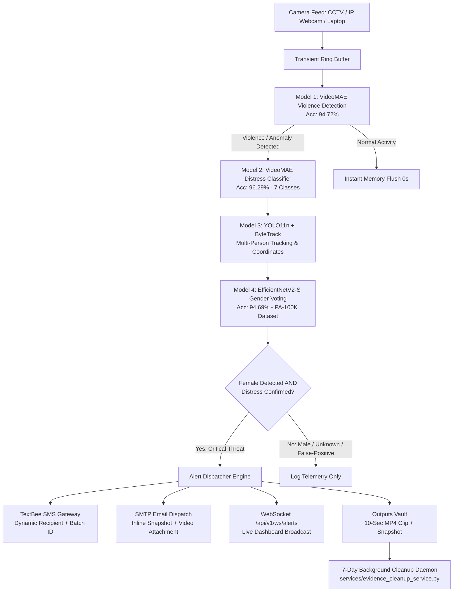

# 🛡️ Real-Time Women Distress Detection & Safety Surveillance System

[](https://www.python.org/)
[](https://fastapi.tiangolo.com/)
[](https://pytorch.org/)
[](https://docs.ultralytics.com/)
[](https://react.dev/)
[](https://www.typescriptlang.org/)
[](https://tailwindcss.com/)
[](/privacy)
[](#-license)

> **An enterprise-grade, privacy-compliant AI surveillance platform engineered for real-time detection of violence, female physical distress, and emergency SOS gestures from CCTV and mobile IP camera streams — coupled with automated multi-channel dispatch (SMS & Email), an evidence Outputs Vault, and strict adherence to India's Digital Personal Data Protection (DPDP) Act, 2023.**

---

## 📑 Table of Contents

- [🎯 System Overview](#-system-overview)
- [✨ Key Capabilities](#-key-capabilities)
- [🧠 Multi-Model AI Architecture](#-multi-model-ai-architecture)
- [🏗️ Technology Stack](#️-technology-stack)
- [📁 Project Directory Structure](#-project-directory-structure)
- [⚡ Quick Start Guide](#-quick-start-guide)
  - [Prerequisites](#prerequisites)
  - [1. Backend Setup](#1-backend-setup)
  - [2. Frontend Setup](#2-frontend-setup)
- [📹 Camera Ingestion: Laptop & Mobile IP Webcam](#-camera-ingestion-laptop--mobile-ip-webcam)
- [📱 Dynamic SMS Alerting (TextBee Gateway)](#-dynamic-sms-alerting-textbee-gateway)
- [🗄️ Evidence Outputs Vault & Retention Lifecycle](#️-evidence-outputs-vault--retention-lifecycle)
- [📡 API Reference](#-api-reference)
- [🖥️ Frontend Dashboard & User Interface](#️-frontend-dashboard--user-interface)
- [⚖️ Statutory Compliance & India's DPDP Act 2023](#️-statutory-compliance--indias-dpdp-act-2023)
- [🧪 Running Verification Tests](#-running-verification-tests)
- [⚠️ Critical Safety & AI Disclaimers](#️-critical-safety--ai-disclaimers)
- [👤 Authors & Licensing](#-authors--licensing)

---

## 🎯 System Overview

Traditional CCTV surveillance systems are passive recording devices — incidents of violence, harassment, or physical assault are typically reviewed only *after* harm has occurred.

**Women Distress Detection AI** transforms surveillance cameras into **proactive safety systems**. By analyzing real-time video frames through spatio-temporal action transformers, motion tracking, and pedestrian gender classification, the platform:
1. Detects violence and physical distress gestures in real time;
2. Filters alerts through a multi-frame temporal voting engine (triggering high-priority alerts **only when female distress is verified**);
3. Dispatches automated SMS notifications via TextBee and rich HTML emails with evidence frames;
4. Automatically saves a high-resolution snapshot and a **10-second MP4 evidence video clip** of the incident in the **Outputs Vault**;
5. Automatically purges expired evidence after 7 days under statutory data minimization guidelines.



---

## ✨ Key Capabilities

- **🚀 Real-Time Spatio-Temporal Inference:** Built on HuggingFace Transformers (`VideoMAE`) and Ultralytics `YOLO11n` for high-throughput video action classification.
- **📱 Android Mobile IP Webcam Integration:** Turn any Android smartphone running the *IP Webcam* app into an intelligent surveillance node over local Wi-Fi. Features auto-normalization (`/videofeed`), dynamic reconnects, and live latency diagnostics without server restarts.
- **📲 Dynamic Dashboard-Configurable SMS Recipient:** Change emergency recipient phone numbers (`+91...`) directly from **Settings → Notifications**. Updates persist in SQLite, synchronize across the backend instantly, and require zero code edits or service reloads.
- **🎥 Automatic Triggered Clip Recording:** Automatically captures a pre- and post-incident **10-second MP4 evidence recording** whenever a critical female distress threat is confirmed.
- **🏛️ Dedicated Outputs Vault (`/dashboard/outputs-vault`):** Standalone dashboard page with real-time metric cards, filterable tabs (*Triggered Video Clips*, *Alert Snapshots*, and *Gender Debug Crops*), in-browser MP4 playback, and secure file deletion.
- **🌓 Dynamic Light & Dark Theme System:** Built on Tailwind CSS v4 with custom variant `@custom-variant dark`, persistent `localStorage` synchronization, and crisp high-contrast UI across all surfaces.
- **⚖️ India DPDP Act 2023 & WCAG 2.1 AA Compliant:** Features dedicated legal portals (`/privacy`, `/terms`, `/cookies`, `/refund`), an interactive floating Cookie & Local Storage Consent Banner, affirmative registration consent checkboxes, data minimization, and an appointed Grievance Redressal Officer.
- **🔒 Zero Third-Party Trackers:** No Google Analytics, no Meta Pixel, and zero advertising beacons. All model inference and video streams execute locally or over private local area networks.

---

## 🧠 Multi-Model AI Architecture

The system executes a sequential pipeline optimized for high accuracy, low latency, and false-positive suppression:

| Pipeline Stage | Model Architecture | Pretraining / Dataset | Classes / Output | Benchmark Metrics |
| :--- | :--- | :--- | :--- | :--- |
| **Stage 1: Violence Detection** | `VideoMAE` (Action Transformer) | Fine-tuned VideoMAE on violence action benchmarks | `Normal`, `Violence` | **94.72% Accuracy** |
| **Stage 2: Distress Classification** | `VideoMAE` (7-class classifier) | Fine-tuned VideoMAE on curated physical distress actions | `Normal`, `Walking`, `Running`, `Punching`, `Violence`, `Fall`, `SOS` | **96.29% Accuracy** |
| **Stage 3: Target Tracking** | `YOLO11n` + `ByteTrack` | Ultralytics YOLO11n + motion Kalman filters | Bounding boxes, track IDs, spatial coordinates `[x1, y1, x2, y2]` | Real-Time (30+ FPS) |
| **Stage 4: Gender Voting** | `EfficientNetV2-S` (`timm`) | PA-100K pedestrian attribute dataset (100,000 images, 224×224) | `Male`, `Female` with temporal voting window (`N=10`) | **94.69% Val Accuracy** |
| **Stage 5: Face Verification** | OpenCV Haar Cascade + Euclidean face distance | Local authorized face feature database | `name`, `confidence`, `thumbnail` | In-memory verification |

### Emergency Alert Trigger Logic
An emergency dispatch is fired **only when all criteria are satisfied simultaneously**:
```python
is_violent == True
AND distress_class in ["Violence", "Punching", "Fall", "SOS"]
AND dominant_gender == "Female"
AND distress_confidence >= ALERT_CONFIDENCE_THRESHOLD (default: 75.0%)
AND (current_time - last_alert_time) >= ALERT_COOLDOWN_SECONDS (default: 300s)
```

---

## 🏗️ Technology Stack

```
┌─────────────────────────────────────────────────────────────────────────┐
│                           FRONTEND (SPA)                                │
│   React 18  •  TypeScript 5.6  •  Vite 8  •  TailwindCSS v4             │
│   Framer Motion  •  React Icons  •  Axios  •  React Hot Toast           │
└────────────────────────────────────┬────────────────────────────────────┘
                                     │ HTTP Proxy / WebSocket WSS
┌────────────────────────────────────▼────────────────────────────────────┐
│                           BACKEND (API)                                 │
│   FastAPI  •  Uvicorn (ASGI)  •  Pydantic v2  •  SQLite3 / SQLAlchemy   │
│   AsyncIO Background Tasks  •  Evidence Cleanup Daemon                  │
└────────────────────────────────────┬────────────────────────────────────┘
                                     │ PyTorch / CUDA Tensors
┌────────────────────────────────────▼────────────────────────────────────┐
│                        COMPUTER VISION CORE                             │
│   PyTorch 2.x  •  Transformers (VideoMAE)  •  Ultralytics YOLO11        │
│   ByteTrack  •  timm (EfficientNetV2-S)  •  OpenCV (cv2)                │
└────────────────────────────────────┬────────────────────────────────────┘
                                     │ Dispatch Gateways
┌────────────────────────────────────▼────────────────────────────────────┐
│                    EXTERNAL COMMUNICATIONS & STORAGE                    │
│   TextBee SMS Gateway  •  SMTP (TLS 587)  •  Local Ring-Buffer NVMe     │
└─────────────────────────────────────────────────────────────────────────┘
```

---

## 📁 Project Directory Structure

```
Real-time-women-distress-detection-using-CCTV/
├── app.py                             # FastAPI server entry point & SPA router
├── config.py                          # Global system thresholds & environment loaders
├── requirements.txt                   # Backend Python dependencies
├── .env.example                       # Reference environment variable blueprint
│
├── database/                          # Persistence & SQLite models
│   ├── database.py                    # SQLAlchemy engine & session factory
│   ├── models.py                      # Incident, Camera, and Setting schemas
│   └── safety_surveillance.db         # Persistent SQLite database
│
├── modules/                           # Deep learning & computer vision modules
│   ├── pipeline.py                    # Master orchestrator for full inference pipeline
│   ├── violence_detector.py           # Model 1: VideoMAE violence classifier
│   ├── distress_detector.py           # Model 2: VideoMAE 7-class distress classifier
│   ├── person_detector.py             # Model 3: YOLO11 + ByteTrack multi-object tracker
│   ├── gender_classifier.py           # Model 4: EfficientNetV2-S gender classification
│   ├── face_recognizer.py             # Haar Cascade & face distance matcher
│   ├── weapon_detector.py             # YOLO weapon detection module
│   ├── triggered_clip_recorder.py     # 10-second automatic MP4 evidence recorder
│   ├── ip_webcam_processor.py         # Threaded RTSP/MJPEG network stream consumer
│   ├── webcam_stream_processor.py     # Local laptop webcam reader
│   └── videomae_base.py               # Shared VideoMAE tensor preprocessor
│
├── routes/                            # FastAPI REST and WebSocket endpoints
│   ├── predict.py                     # POST /predict — multi-model video analysis
│   ├── ip_webcam.py                   # GET/PUT /api/v1/ipwebcam/config, connect, disconnect
│   ├── settings.py                    # GET/PUT /api/v1/settings/notifications (dynamic SMS)
│   ├── outputs.py                     # GET/DELETE /api/v1/outputs (Outputs Vault API)
│   ├── emergency.py                   # POST /api/v1/emergency/send
│   ├── emergency_contacts.py          # GET/PUT /api/v1/emergency-contacts
│   ├── cameras.py                     # Camera hardware registry
│   ├── history.py                     # GET /api/v1/history (incident audit trails)
│   └── ws.py                          # WebSocket /api/v1/ws/alerts live broadcast
│
├── services/                          # Business logic & background daemons
│   ├── alert_dispatcher.py            # Cooldown-guarded parallel alert orchestrator
│   ├── sms_service.py                 # TextBee SMS Gateway client with batch tracking
│   ├── notification_settings_service.py # Dynamic DB-backed SMS configuration manager
│   ├── camera_connection_service.py   # IP camera config & URL normalization service
│   ├── evidence_cleanup_service.py    # 7-day automated evidence purge background task
│   └── triggered_clip_service.py      # Triggered clip storage & file lifecycle
│
├── models/                            # PyTorch model checkpoints & configurations
│   ├── model1/                        # videomae_model1_best.pth (~329 MB)
│   ├── model2/                        # videomae_model2_best.pth (~329 MB)
│   ├── model3a/                       # yolo11n.pt (~5.6 MB)
│   └── model4/                        # gender_detection_best.pth (~78 MB)
│
├── outputs/                           # Generated surveillance evidence (gitignored)
│   ├── triggered_clips/               # Automatic 10-second MP4 evidence clips
│   └── debug_gender/                  # Diagnostic gender classification crops
│
├── frontend/                          # React + TypeScript single-page application
│   ├── src/
│   │   ├── pages/
│   │   │   ├── Landing.tsx            # Public landing page with statutory disclaimer
│   │   │   ├── Login.tsx              # Secure operator login with Google SSO
│   │   │   ├── Register.tsx           # DPDP-compliant registration with consent checkbox
│   │   │   ├── legal/                 # Statutory legal portals (DPDP Act 2023)
│   │   │   │   ├── PrivacyPolicy.tsx  # /privacy
│   │   │   │   ├── TermsOfService.tsx # /terms
│   │   │   │   ├── CookiePolicy.tsx   # /cookies
│   │   │   │   └── RefundPolicy.tsx   # /refund
│   │   │   └── dashboard/             # Dashboard modules
│   │   │       ├── DashboardHome.tsx  # Summary metrics & quick preview
│   │   │       ├── LiveDetection.tsx  # Live monitoring (Laptop Webcam & IP Webcam)
│   │   │       ├── UploadVideo.tsx    # Footage upload & multi-stage analysis
│   │   │       ├── OutputsVault.tsx   # Dedicated Outputs Vault page
│   │   │       ├── History.tsx        # Incident audit logs
│   │   │       ├── Analytics.tsx      # Trend charts & distributions
│   │   │       ├── Notifications.tsx  # Alert broadcast dispatch logs
│   │   │       ├── Settings.tsx       # Dynamic SMS settings & Light/Dark themes
│   │   │       └── HelpSupport.tsx    # Technical documentation & FAQs
│   │   ├── components/
│   │   │   ├── common/                # CookieConsentBanner, RouteLoader
│   │   │   ├── legal/                 # LegalLayout (TOC, Print, Header)
│   │   │   ├── settings/              # CameraSettingsCard, BackendStatusCard
│   │   │   └── dashboard/             # OutputsGallery media browser
│   │   └── contexts/                  # ThemeContext, AuthContext, DashboardContext
│   └── package.json
│
└── tests/                             # Comprehensive automated test suite
    ├── test_dynamic_sms_settings.py   # Dynamic SMS persistence & E.164 validation tests
    ├── test_ip_webcam_integration.py  # IP Webcam URL normalization & connection tests
    ├── test_triggered_clip_end_to_end.py # Real inference & triggered clip verification
    └── test_history_persistence.py    # Database persistence tests
```

---

## ⚡ Quick Start Guide

### Prerequisites

- **Python:** 3.10, 3.11, or 3.12 (Virtual environment strongly recommended)
- **Node.js:** 18+ and `npm`
- **FFmpeg:** Installed and added to system `PATH`
- **GPU (Optional but Recommended):** NVIDIA GPU with CUDA 11.8+ / 12.x for real-time inference (falls back to CPU automatically)

---

### 1. Backend Setup

```bash
# 1. Clone the repository
git clone https://github.com/Sagarspoojary/Real-time-women-distress-detection-using-CCTV.git
cd Real-time-women-distress-detection-using-CCTV

# 2. Create and activate a Python virtual environment
python -m venv venv

# Windows (PowerShell):
.\venv\Scripts\Activate.ps1
# macOS / Linux:
source venv/bin/activate

# 3. Upgrade pip and install dependencies
pip install --upgrade pip
pip install -r requirements.txt

# 4. Verify model weights exist in models/ directory:
# models/model1/videomae_model1_best.pth
# models/model2/videomae_model2_best.pth
# models/model3a/yolo11n.pt
# models/model4/gender_detection_best.pth

# 5. Configure environment variables
cp .env.example .env
# Edit .env with your SMTP credentials, TextBee API keys, and camera IDs

# 6. Launch the FastAPI server
uvicorn app:app --reload --host 127.0.0.1 --port 8000
```
*Backend API and Swagger documentation will be live at `http://127.0.0.1:8000/docs`.*

---

### 2. Frontend Setup

In a separate terminal window:

```bash
# 1. Navigate to the frontend directory
cd frontend

# 2. Install Node dependencies
npm install

# 3. Launch the Vite development server
npm run dev
```
*The React Dashboard will be accessible at `http://localhost:5173`.*

> **Production Build:** To build the optimized production client served directly by FastAPI (single-port deployment):
> ```bash
> cd frontend && npm run build
> ```
> FastAPI will automatically serve the built SPA bundle at `http://127.0.0.1:8000/`.

---

## 📹 Camera Ingestion: Laptop & Mobile IP Webcam

The system provides dual camera modes configured from the **Live Detection** page (`/dashboard/live-detection`):

### Mode A: Integrated Laptop Camera
- Select **"Laptop Camera"** from the camera selector.
- Click **"Start Monitoring"** to initialize local frame capture (`WEBCAM_INDEX=0`).

### Mode B: Mobile Android IP Webcam (Same Wi-Fi)
Turn any Android phone into an HD security camera without proprietary cloud services:
1. Connect the Android phone and host computer to the **same local Wi-Fi network**.
2. Install the free **IP Webcam** app (by *Pavel Khlebovich*) from Google Play Store.
3. Open the app, scroll to the bottom, and tap **"Start server"**.
4. Note the displayed URL on the phone screen (e.g. `http://192.168.1.100:8080`).
5. In the dashboard (**Live Detection** or **Settings → Camera**):
   - Enter the IP address into the input field.
   - Click **"Test Connection"** to verify frame retrieval.
   - Click **"Save Camera Address"**.
6. Select **"Mobile IP Webcam"** and click **"Start Monitoring"**.

> **Automatic URL Normalization:** You can input `192.168.1.100:8080`, `http://192.168.1.100:8080`, or `http://192.168.1.100:8080/videofeed` — the backend automatically sanitizes, validates against cloud metadata SSRF vectors, and targets the optimal MJPEG streaming buffer.

---

## 📱 Dynamic SMS Alerting (TextBee Gateway)

Unlike static systems requiring hardcoded configuration in `.env` or application restarts, our platform allows operators to update the SMS recipient destination on the fly:

1. Navigate to **Dashboard → Settings → Notifications**.
2. Under **SMS Alert Dispatcher**, enter the target mobile number in international **E.164 format** (e.g., `+918296387497` or `+14155552671`).
   - *10-digit Indian numbers (`8296387497`) are automatically normalized with the `+91` country code.*
3. Click **"Save Changes"**.
   - The new recipient is validated, stored in SQLite (`database/safety_surveillance.db`), and immediately utilized by `services/sms_service.py`.
4. Click **"Send Test SMS"** to dispatch a diagnostic verification SMS via TextBee and inspect the provider Batch ID in the terminal.

---

## 🗄️ Evidence Outputs Vault & Retention Lifecycle

Surveillance footage that contains confirmed distress incidents is preserved as evidentiary proof in the dedicated **Outputs Vault**:

- **Location:** `outputs/`
  - `outputs/triggered_clips/`: 10-second MP4 video recordings of verified incidents.
  - `outputs/debug_gender/`: Gender classifier diagnostic crops for operator audit.
  - `outputs/`: High-resolution alert evidence snapshot frames (`.jpg`).
- **Dashboard Interface:** Accessible at `/dashboard/outputs-vault` with tabbed category filters, file sizes, creation timestamps, thumbnail previews, modal video player, and one-click deletion.
- **Automated 7-Day Purge Daemon:** To adhere to India's DPDP Act Section 8(7) data minimization principles, `services/evidence_cleanup_service.py` runs as an asynchronous background task on server startup, unlinking files older than **7 calendar days** automatically.

---

## 📡 API Reference

### Surveillance & Computer Vision

| Method | Endpoint | Description | Request Payload | Response |
| :--- | :--- | :--- | :--- | :--- |
| `POST` | `/predict` | Full video pipeline analysis | `multipart/form-data` (`file`) | Structured JSON with violence, distress, tracks, and gender |
| `GET` | `/health` | Backend status & health check | None | `{"status": "online", "message": "..."}` |

### IP Webcam & Camera Management

| Method | Endpoint | Description | Request Payload | Response |
| :--- | :--- | :--- | :--- | :--- |
| `GET` | `/api/v1/ipwebcam/config` | Retrieve current IP camera URL | None | `{"camera_id": "...", "stream_url": "..."}` |
| `PUT` | `/api/v1/ipwebcam/config` | Update & reconnect IP camera | `{"stream_url": "http://192.168.x.x:8080/video"}` | Updated camera configuration |
| `POST` | `/api/v1/ipwebcam/test` | Test frame extraction from IP | `{"stream_url": "..."}` | `{"status": "success", "reachable": true}` |
| `POST` | `/api/v1/ipwebcam/connect` | Start IP camera background thread | None | `{"status": "connected"}` |
| `POST` | `/api/v1/ipwebcam/disconnect` | Stop IP camera background thread | None | `{"status": "disconnected"}` |

### Dynamic Notification & SMS Settings

| Method | Endpoint | Description | Request Payload | Response |
| :--- | :--- | :--- | :--- | :--- |
| `GET` | `/api/v1/settings/notifications` | Get active recipient & gateway status | None | `{"sms_recipient_number": "+91...", ...}` |
| `PUT` | `/api/v1/settings/notifications` | Update active SMS destination | `{"sms_recipient_number": "+918296387497"}` | Updated settings summary |
| `POST` | `/api/v1/settings/notifications/test-sms` | Send test verification SMS | None | `{"status": "success", "batch_id": "..."}` |
| `DELETE` | `/api/v1/settings/notifications/recipient` | Reset recipient to `.env` default | None | `{"status": "reset"}` |

### Outputs Vault & Evidence Management

| Method | Endpoint | Description | Query Parameters | Response |
| :--- | :--- | :--- | :--- | :--- |
| `GET` | `/api/v1/outputs` | List categorized output artifacts | None | Lists of `whole_images`, `triggered_clips`, `debug_gender` |
| `DELETE` | `/api/v1/outputs/file` | Safely delete an evidence file | `?path=triggered_clips/clip_01.mp4` | `{"status": "success"}` |

### Incident History & Real-Time Alerts

| Method | Endpoint | Description | Query / Protocol | Response |
| :--- | :--- | :--- | :--- | :--- |
| `GET` | `/api/v1/history` | Paginated incident history | `?skip=0&limit=100` | Array of historical incidents |
| `WS` | `/api/v1/ws/alerts` | Live WebSocket incident feed | WebSocket Protocol | Real-time threat broadcast events |

---

## 🖥️ Frontend Dashboard & User Interface

The modern Single-Page Application (SPA) features a responsive glassmorphism design:

- **Public & Authentication Pages:**
  - `/` & `/landing`: Hero section, model benchmark cards, engineered stack, pipeline overview, statutory disclaimer banner, and compliance footer.
  - `/login`: Operator terminal authentication supporting email/password and Google SSO.
  - `/register`: Operator registration with DPDP Act consent checkbox and data minimization notice.
- **Legal & Compliance Portals:**
  - `/privacy`: Complete DPDP Act 2023 privacy notice, Data Principal rights, and Grievance Officer details.
  - `/terms`: Terms of Service, acceptable use policy, and AI liability disclaimers.
  - `/cookies`: Audit of local storage keys, zero ad-tracker guarantee, and interactive preference modal.
  - `/refund`: 14-day institutional pilot evaluation guarantee and SLA outage credits.
- **Operational Dashboard (`/dashboard`):**
  - **Live Detection (`/dashboard/live-detection`):** Real-time monitoring center with camera switching (Laptop vs Mobile IP Webcam), pause/resume scans, and live bounding-box overlays.
  - **Upload Video (`/dashboard/upload-video`):** File dropzone supporting MP4/AVI/MOV with progress bars, threat breakdown cards, and JSON telemetry export.
  - **Outputs Vault (`/dashboard/outputs-vault`):** Standalone evidence manager with quick count metrics, filterable category tabs, video player modal, and file deletion.
  - **Analytics (`/dashboard/analytics`):** Temporal incident graphs, threat severity charts, and gender distribution metrics.
  - **Settings (`/dashboard/settings`):** Dynamic SMS recipient management, email configuration, camera IP setup, and Light/Dark theme selector.

---

## ⚖️ Statutory Compliance & India's DPDP Act 2023

To ensure complete legal safety and protect operators and deploying organizations from regulatory liabilities:

1. **Informed Affirmative Consent (Section 6):** Registration and emergency contact configuration forms require explicit, unambiguous affirmative consent before credentials or phone numbers can be processed.
2. **Data Minimization (Section 4):** The system strictly limits data collection to operator credentials and transient optical frames. Extraneous demographic profiling is disabled.
3. **Statutory Retention & Automated Purge (Section 8):** Continuous normal camera frames are processed transiently in volatile RAM and discarded immediately (0s retention). Incident evidence files are purged automatically after 7 calendar days.
4. **Data Fiduciary & Grievance Redressal Officer (Section 13):**
   - **Data Fiduciary:** AegisSafe AI Technologies Private Limited
   - **CIN:** U72900KA2024PTC184920
   - **Registered Office:** Tech Park Central, 4th Floor, Outer Ring Road, Bellandur, Bengaluru, Karnataka 560103, India
   - **Designated Grievance Officer:** Mr. Arvind Raman
   - **Statutory Contact:** `grievance@aegissafe.ai` | `privacy@aegissafe.ai`
   - **SLA Commitment:** Written acknowledgment within **48 hours**; resolution within **30 calendar days**.

---

## 🧪 Running Verification Tests

The repository maintains an automated Python unit and integration test suite:

```bash
# Activate the virtual environment
source venv/bin/activate          # macOS/Linux
# .\venv\Scripts\Activate.ps1    # Windows

# 1. Run Dynamic SMS Settings persistence and E.164 validation tests:
python -m unittest tests/test_dynamic_sms_settings.py

# 2. Run IP Webcam URL normalization and connection tests:
python -m unittest tests/test_ip_webcam_integration.py

# 3. Run full test suite:
python -m unittest discover tests/
```

To validate the frontend TypeScript types and production build:
```bash
cd frontend
npm run build
```

---

## ⚠️ Critical Safety & AI Disclaimers

> [!CAUTION]
> **1. NOT A REPLACEMENT FOR EMERGENCY SERVICES (112):**  
> This software is an assistive computer-vision screening tool designed to aid security operators. It does **NOT** replace government emergency response agencies, police first-responders, or human judgment. In any active emergency or threat to life, operators must **immediately dial 112 (National Emergency Helpline) or 100 (Police)**.

> [!WARNING]
> **2. MANDATORY STATUTORY CCTV SIGNAGE REQUIREMENT:**  
> Under Indian law (including DPDP Act 2023 and Section 354C IPC / Section 77 BNS), facility owners deploying CCTV surveillance must erect prominent physical warning signage at all entrance points:  
> *"NOTICE: This premises is monitored by 24x7 CCTV & AI Video Analytics for Women Safety and Public Crime Prevention. Purpose: Emergency Distress Response. Contact: privacy@aegissafe.ai."*

> [!NOTE]
> **3. PROBABILISTIC NATURE OF MACHINE LEARNING:**  
> Deep learning models operate on statistical probabilities. Performance may vary depending on camera resolution, low illumination, optical occlusions, or abnormal angles. The developers make no warranty of 100% detection accuracy.

---

## 👤 Authors & Licensing

- **Lead Developer:** Sagar S Poojary ([GitHub: @Sagarspoojary](https://github.com/Sagarspoojary))
- **Legal & Systems Engineering:** Antigravity AI Assistant & AegisSafe Engineering
- **License:** This project is licensed for **Academic, Research, and Authorized Institutional Security Pilot Demonstrations**. Unauthorized commercial re-distribution of proprietary model weights without written consent is strictly prohibited.
